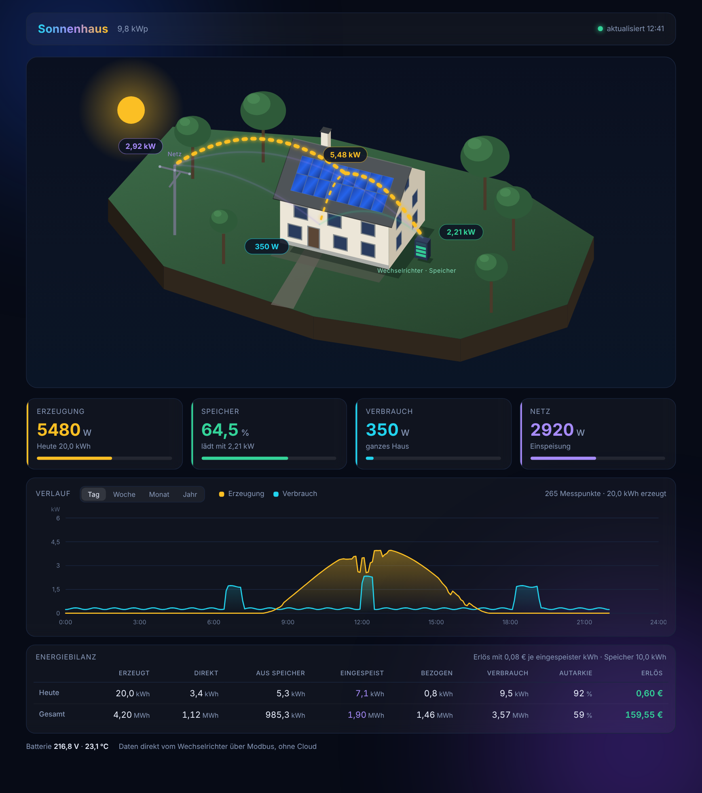

# sungrow-local

Ein lokales Dashboard für **Sungrow-SH-Hybridwechselrichter**, das nur liest. Es spricht
im eigenen Netz über Modbus TCP mit dem WiNet-S-Dongle, hebt einen kleinen Verlauf auf und
zeigt alles im Browser. Ohne Cloud-Konto, ohne Home Assistant, ohne zusätzliche Pakete.

[English version](README.md)



## Wozu

Sungrow-Wechselrichter melden ihre Daten ab Werk an die iSolarCloud. Wer die Daten lieber
zu Hause behält oder den Wechselrichter ganz vom Internet trennen will, möchte trotzdem
sehen, was die Anlage macht. Genau das macht sungrow-local, und nichts darüber hinaus.

- **Eine Python-Datei**, nur Standardbibliothek, Python 3.8 oder neuer. Läuft auf einem
  alten Mac, einem Raspberry Pi, einem NAS oder jedem Linux-Rechner.
- **Nur lesend.** Es schreibt nie ein Modbus-Register und kann daher keine Einstellung am
  Wechselrichter verändern. Das gilt für dieses Programm, nicht für den Port, den es
  braucht: Modbus TCP am WiNet-S hat keine Anmeldung, den Dongle deshalb vom übrigen Netz
  abschirmen, siehe [WiNet-S abschotten](docs/block-cloud.de.md#winet-s-abschotten).
- **Live-Ansicht** mit animierten Energieflüssen zwischen Dach, Speicher, Haus und Netz.
- **Verlauf** für den Tag (Kurve in 5-Minuten-Schritten) und je Woche, Monat und Jahr.
- **Energiebilanz** für heute und gesamt: erzeugt, direkt verbraucht, aus dem Speicher,
  eingespeist, bezogen, Verbrauch, Autarkie und Einspeiseerlös.
- Oberfläche auf Deutsch und Englisch.

Wer schon Home Assistant betreibt, ist mit der
[Sungrow-SHx-Modbus-Integration](https://github.com/mkaiser/Sungrow-SHx-Inverter-Modbus-Home-Assistant)
umfassender bedient. sungrow-local ist für alle, die einfach nur ein Dashboard wollen.

## Getestete Hardware

| Wechselrichter | Dongle | Stand |
|---|---|---|
| Sungrow SH15T mit SBH-Speicher | WiNet-S, per Kabel angeschlossen | läuft |

Sungrow veröffentlicht ein gemeinsames Modbus-Protokoll für seine Hybridwechselrichter
(SH-RS, SH-RT, SH-T). Andere SH-Modelle laufen deshalb wahrscheinlich auch, sind aber
nicht getestet. Rückmeldungen und Pull Requests sind willkommen.

## Schnellstart

1. **Wechselrichter vorbereiten**: WiNet-S ins Netzwerk bringen und Modbus TCP einschalten.
   Schritt für Schritt in [docs/setup-winet.de.md](docs/setup-winet.de.md).
2. **Ohne Hardware ausprobieren**, wenn du magst:
   ```sh
   python3 sungrow_local.py --demo
   ```
   Dann http://localhost:8787 öffnen, dort läuft eine simulierte Anlage.
3. **Einrichten**: `config.example.json` nach `config.json` kopieren und mindestens
   `inverter_host` (IP-Adresse des WiNet-S), `peak_power_kw`, `feed_in_tariff` und
   `"language": "de"` setzen.
4. **Verbindung prüfen**:
   ```sh
   python3 sungrow_local.py --check
   ```
   Das liest den Wechselrichter einmal aus und zeigt alle Werte. Klappt das, klappt alles.
5. **Starten**:
   ```sh
   python3 sungrow_local.py
   ```
   und im Browser http://<dein-rechner>:8787 öffnen.

Für den automatischen Start siehe [docs/run-as-service.md](docs/run-as-service.md)
(systemd für Linux und Raspberry Pi, launchd für macOS).

## Einstellungen

Alle Einstellungen stehen in `config.json`, was fehlt, behält den Standardwert. Die
vollständige Liste steht im [englischen README](README.md#configuration), die wichtigsten:

| Schlüssel | Bedeutung |
|---|---|
| `inverter_host` | IP-Adresse des WiNet-S |
| `plant_name` | Titel im Dashboard |
| `peak_power_kw` | Spitzenleistung der Anlage in kWp |
| `feed_in_tariff` | Vergütung je eingespeister kWh, `0` blendet den Erlös aus |
| `language` | `de` oder `en` |
| `basic_auth` | `"benutzer:passwort"` (Passwort mindestens 8 Zeichen) oder eine gehashte Anmeldung, siehe unten |
| `lan_without_login` | mit `basic_auth`: andere Geräte im Heimnetz, die sich direkt verbinden, brauchen keine Anmeldung (Standard `false`) |
| `cloudflare_access` | Team-Domain und AUD-Tag einer Cloudflare-Access-Anwendung, siehe unten |
| `allowed_hosts` | Hostnamen, auf die das Dashboard außer IP-Adressen, `localhost` und dem eigenen Rechnernamen antwortet; nötig hinter Reverse Proxy oder Tunnel |
| `trusted_proxies` | Adressen oder Netze (`"192.168.1.5"`, `"10.0.0.0/24"`), deren Verbindungen immer als über einen Proxy gekommen gelten |

Die Einstellungen werden beim Start geprüft. Ein vertippter Schlüssel, ein falscher Typ
(`"false"` in Anführungszeichen, `"8787"` als Text) oder ein zu kurzes Passwort beenden das
Programm mit einer Meldung, die die Einstellung nennt. Schlüssel, die mit `_` beginnen,
werden übergangen und taugen als Kommentar.

**Gehashtes Passwort.** Statt des Passworts im Klartext kann `config.json` einen Hash
enthalten. `python3 sungrow_local.py --hash-password` fragt Benutzer und Passwort ab und
gibt die Zeile für `config.json` aus. So oder so: Steht eine Anmeldung in `config.json`, die
Datei nur für dich lesbar machen, `chmod 600 config.json`.

## Gut zu wissen

- **Der WiNet-S nimmt nur eine Modbus-Verbindung gleichzeitig an** und wirft sie hinaus,
  wenn die Anfragen zu schnell kommen. sungrow-local öffnet eine Verbindung je Messung und
  wartet 0,35 Sekunden zwischen den Anfragen. Kein zweites Modbus-Programm gleichzeitig
  auf denselben Dongle loslassen.
- **Die Registernummern liegen um eins daneben.** Die Sungrow-Doku zählt ab 1, die Adresse
  auf der Leitung ab 0. Register 13002 im Handbuch ist Adresse 13001. Im Code stehen immer
  die Leitungsadressen, siehe [docs/registers.md](docs/registers.md).
- **Das Lastregister (13008) ist unzuverlässig** an der getesteten Anlage. Der
  Hausverbrauch wird deshalb als PV + Batterie + Netz gerechnet.
- Die Tageswerte kommen aus den Zählern des Wechselrichters und werden ab dem Tag
  gespeichert, an dem sungrow-local zum ersten Mal läuft. Ältere Werte gibt es nur in der
  Cloud.
- Messungen mit unmöglichen Werten (Ladestand über 100 %, PV-Leistung weit über der
  Spitzenleistung) werden nicht gespeichert, und das Dashboard zeigt die Verbindung als
  verloren, wenn drei Abfragen lang keine Messung kam.

## Zugriff von unterwegs

Das Dashboard hat ab Werk keine Anmeldung und ist fürs Heimnetz gedacht. Ohne Anmeldung
beantwortet es nur direkte Anfragen von lokalen Adressen. Abgewiesen werden Anfragen von
öffentlichen Adressen (Portfreigabe, Rechner mit öffentlicher Adresse) und Anfragen, die
über einen Reverse Proxy oder Tunnel kommen (erkennbar an `X-Forwarded-For`, `X-Real-IP`,
`Forwarded`, `CF-Connecting-IP` oder `Via`). Ein Proxy, der keine dieser Kopfzeilen
schickt, sieht aus wie eine direkte Anfrage; läuft er auf einem anderen Rechner, gehört
er in `trusted_proxies`. Bitte keinen Port am Router freigeben.

Egal welcher Weg: den öffentlichen Hostnamen in `allowed_hosts` eintragen, zum Beispiel
`"allowed_hosts": ["pv.example.org"]`. Unbekannte Hostnamen weist das Dashboard ab (421),
das schützt vor DNS-Rebinding über Webseiten, die im Heimnetz geöffnet werden.

Für unterwegs gibt es drei Wege:

- **Das eigene VPN.** Nichts einzurichten.
- **Anmeldung plus Reverse Proxy.** `basic_auth` auf `"benutzer:passwort"` setzen und das
  Dashboard hinter einen Reverse Proxy mit HTTPS stellen. Dann braucht jede Anfrage die
  Anmeldung, auch daheim. Sollen Geräte im Heimnetz ohne auskommen, `lan_without_login` auf
  `true` setzen. Die Ausnahme gilt nur für direkte Verbindungen von anderen Geräten, nie für
  Anfragen vom selben Rechner oder über einen Proxy. Läuft der Proxy auf einem anderen
  Rechner und schickt kein `X-Forwarded-For`, seine Adresse in `trusted_proxies`
  eintragen. Hinter Source-NAT oder in einem Container mit User-Mode-Netzwerk (rootless
  Docker oder Podman) erscheinen alle Besucher mit einer privaten Adresse; dort
  `lan_without_login` aus lassen. Der eingebaute Server spricht nur HTTP, die Anmeldung ist
  also nur durch das HTTPS des Proxys geschützt.
- **Cloudflare Tunnel mit Cloudflare Access.** Für den Hostnamen eine Access-Anwendung
  anlegen und Team-Domain sowie den AUD-Tag der Anwendung eintragen (in den Einstellungen
  der Access-Anwendung als *Application Audience (AUD) Tag*):
  ```json
  "cloudflare_access": {
    "team_domain": "deinteam.cloudflareaccess.com",
    "audience": "<AUD-Tag deiner Access-Anwendung>"
  }
  ```
  sungrow-local prüft dann das signierte Token, das Access jeder Anfrage mitgibt: Signatur
  gegen die öffentlichen Schlüssel deines Teams, Zielgruppe, Aussteller und Ablaufzeit.
  `audience` darf auch eine Liste sein, wenn mehrere Access-Anwendungen zum selben
  Dashboard führen.

Wie Anfragen geprüft werden und wie man Probleme meldet: [SECURITY.md](SECURITY.md).

## Die Cloud aussperren

Läuft das Dashboard, kann man den Wechselrichter vom Internet trennen und nur für
Firmware-Updates kurz wieder freigeben. Wie das geht und worauf zu achten ist:
[docs/block-cloud.de.md](docs/block-cloud.de.md).

## Lizenz

MIT, siehe [LICENSE](LICENSE). Das Projekt hat nichts mit der Firma Sungrow zu tun. Nutzung
auf eigene Verantwortung; es liest nur Werte, für die Anlage bist du selbst verantwortlich.
