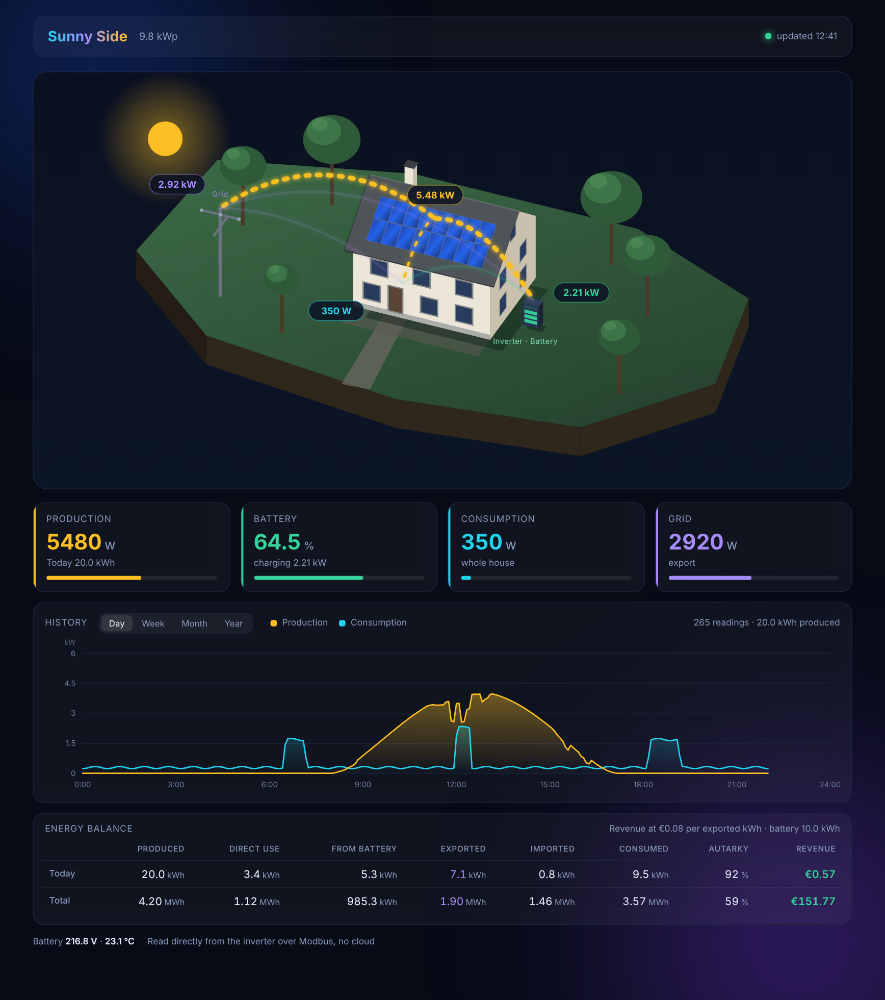
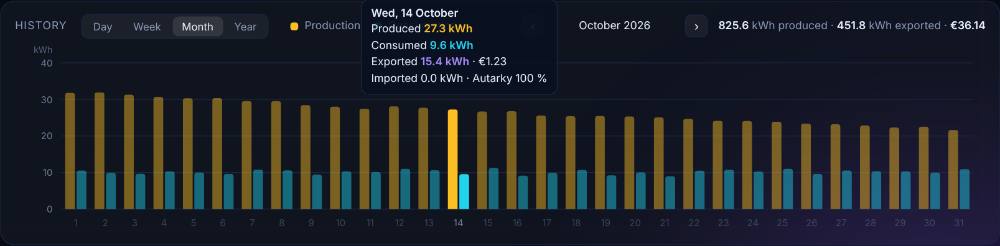

# sungrow-local

A local, read-only dashboard for **Sungrow SH hybrid inverters**. It talks to the
inverter's WiNet-S dongle over Modbus TCP in your own network, keeps a small history and
shows everything in a browser. No cloud account, no Home Assistant, no extra packages.

[Deutsche Fassung](README.de.md)



## Why

Sungrow inverters report to the iSolarCloud by default. If you would rather keep your
data at home, or want to block the inverter from the internet altogether, you still want
to see what your system is doing. sungrow-local does exactly that and nothing more.

- **One Python file**, standard library only, Python 3.8 or newer. Runs on an old Mac,
  a Raspberry Pi, a NAS or any Linux box.
- **Read-only.** It never writes a Modbus register, so it cannot change a setting of your
  inverter.
- **Live view** with animated energy flows between roof, battery, house and grid.
- **History** for the day (5-minute curve) and per week, month and year.
- **Energy balance** for today and in total: produced, direct use, from battery, exported,
  imported, consumption, autarky and feed-in revenue.
- English and German interface.



If you already run Home Assistant, the
[Sungrow SHx Modbus integration](https://github.com/mkaiser/Sungrow-SHx-Inverter-Modbus-Home-Assistant)
is the more complete choice. sungrow-local is for people who just want a dashboard.

## Tested hardware

| Inverter | Dongle | Status |
|---|---|---|
| Sungrow SH15T with SBH battery | WiNet-S, connected by cable | works |

Sungrow publishes one Modbus protocol for its residential hybrid inverters (SH-RS, SH-RT,
SH-T), so other SH models will probably work as well, but they have not been tested.
Reports and pull requests are welcome.

## Quick start

1. **Prepare the inverter**: connect the WiNet-S to your network and switch on Modbus TCP.
   Step by step in [docs/setup-winet.md](docs/setup-winet.md).
2. **Try it without hardware** first, if you like:
   ```sh
   python3 sungrow_local.py --demo
   ```
   Open http://localhost:8787 and you see a simulated system.
3. **Configure**: copy `config.example.json` to `config.json` and set at least
   `inverter_host` (the IP address of the WiNet-S), `peak_power_kw` and `feed_in_tariff`.
4. **Check the connection**:
   ```sh
   python3 sungrow_local.py --check
   ```
   This reads the inverter once and prints all values. If that works, everything works.
5. **Run it**:
   ```sh
   python3 sungrow_local.py
   ```
   and open http://<your-computer>:8787 in a browser.

To start it automatically, see [docs/run-as-service.md](docs/run-as-service.md)
(systemd for Linux and Raspberry Pi, launchd for macOS).

## Configuration

All settings live in `config.json`. Everything you leave out keeps its default.

| Key | Default | Meaning |
|---|---|---|
| `inverter_host` | `192.168.1.100` | IP address of the WiNet-S |
| `inverter_port` | `502` | Modbus TCP port |
| `unit_id` | `1` | Modbus unit (slave) id |
| `http_host` | `0.0.0.0` | address the web server listens on |
| `http_port` | `8787` | port of the dashboard |
| `plant_name` | `My PV system` | title shown in the dashboard |
| `peak_power_kw` | `10.0` | peak power of the PV array, scales the production bar |
| `feed_in_tariff` | `0.08` | money per exported kWh, `0` hides the revenue |
| `currency` | `€` | currency symbol |
| `language` | `en` | `en` or `de` |
| `poll_seconds` | `10` | seconds between two readings, at least 5 |
| `request_pause` | `0.35` | pause between Modbus requests, see below |
| `keep_days` | `400` | how long the minute values are kept |
| `database` | `sungrow-local.db` | SQLite file for the history |
| `basic_auth` | `null` | `"user:password"` to require a login |
| `lan_without_login` | `true` | private addresses do not need the login |
| `trust_cloudflare_access` | `false` | see "Access from outside" |

## API

The dashboard is built on a small JSON API that you can use for your own tools:

| Endpoint | Content |
|---|---|
| `/api/now` | current powers, state of charge and today's and total energy counters |
| `/api/day?offset=0` | today's curve in 5-minute steps, `offset=1` for yesterday |
| `/api/days` | one row per day: date, produced, direct, charged, discharged, imported, exported (kWh) |
| `/api/config` | plant name, peak power, tariff, currency, language |

## Things worth knowing

- **The WiNet-S accepts only one Modbus connection at a time** and drops it when requests
  arrive too quickly. sungrow-local opens one connection per reading and pauses 0.35 s between
  requests. Do not run a second Modbus client against the same dongle at the same time.
- **Register numbers are off by one.** Sungrow's documentation counts from 1, the address
  on the wire starts at 0. Register 13002 in the manual is address 13001. All addresses in
  the code are wire addresses, see [docs/registers.md](docs/registers.md).
- **The load register (13008) is not reliable** on the tested system. The house consumption
  is therefore calculated as PV + battery + grid.
- Daily values come from the inverter's own counters and are stored from the day you start
  sungrow-local. Older history is only in the cloud.

## Access from outside

The dashboard has no login by default and is meant for your home network. Do not forward
the port on your router. For access on the road you can use your VPN, or:

- set `basic_auth` to `"user:password"` and put the dashboard behind a reverse proxy with
  HTTPS, or
- publish it through a Cloudflare Tunnel with a Cloudflare Access policy and set
  `trust_cloudflare_access` to `true`. Requests that come through a Cloudflare tunnel are
  refused unless Access has checked them or `basic_auth` is set.

## Blocking the cloud

Once the dashboard runs, you can cut the inverter off from the internet and open it again
only for firmware updates. How and what to watch out for:
[docs/block-cloud.md](docs/block-cloud.md).

## License

MIT, see [LICENSE](LICENSE). This project is not affiliated with Sungrow. Use at your own
risk; it only reads values, but you are responsible for your installation.
