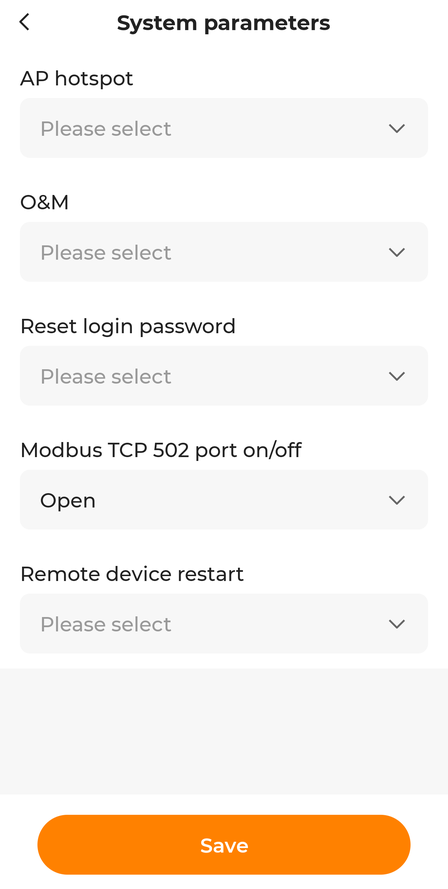

# Wechselrichter vorbereiten: WiNet-S und Modbus TCP

[English version](setup-winet.md)

sungrow-local liest den Wechselrichter über den **WiNet-S** aus, den
Kommunikationsdongle im COM-Anschluss des Wechselrichters. Dafür braucht es zwei Dinge:
Der Dongle muss im Heimnetz sein, und sein Modbus-TCP-Port muss offen sein.

## 1. WiNet-S ins Netzwerk bringen

Der WiNet-S kann per WLAN oder per Netzwerkkabel ins Netz.

- **Kabel ist die bessere Wahl.** Modbus über den Dongle läuft am Kabel deutlich stabiler.
  Steht der Wechselrichter weit vom Router weg, reicht ein Paar Powerline-Adapter (genau so
  läuft die getestete Anlage).
- Der Dongle holt sich seine Adresse per DHCP vom Router. In der Geräteliste des Routers
  taucht er eventuell als "Espressif" auf (der Chip darin), an der getesteten Anlage begann
  die MAC-Adresse mit `ac:19:9f` (Sungrow).
- **Er antwortet unter Umständen nicht auf Ping.** Findet ein Netzwerkscan ihn nicht, in
  der DHCP-Liste des Routers oder in der ARP-Tabelle (`arp -a`) nachsehen.
- **Feste Adresse vergeben** per DHCP-Reservierung im Router, damit das Dashboard ihn immer
  unter derselben IP findet.

## 2. Modbus TCP einschalten

Ab Werk ist Port 502 am WiNet-S zu. Es gibt zwei Wege, ihn zu öffnen.

> **Zuerst lesen.** Modbus TCP kennt keine Anmeldung. Ist Port 502 offen, kann *jedes*
> Gerät, das den Dongle erreicht, den Wechselrichter auslesen, und man muss davon ausgehen,
> dass es auch Einstellungen schreiben kann (Speichermodus, Zwangsladung, Einspeisegrenze).
> sungrow-local selbst liest nur, kann den Port, den es braucht, aber nicht schützen. Den
> WiNet-S deshalb in ein Netzsegment stellen, in dem nur der Rechner mit sungrow-local Port
> 502 erreicht, siehe [WiNet-S abschotten](block-cloud.de.md#winet-s-abschotten).

### Weg A: iSolarCloud-App

1. In der iSolarCloud-App die Anlage öffnen.
2. In der Geräteliste das Kommunikationsmodul, also den **WiNet-S**, wählen und seine
   Einstellungen öffnen.
3. **System parameters** öffnen.
4. **Modbus TCP 502 port on/off** auf **Open** stellen.
5. **Save** tippen.



Der Bildschirm oben stammt von der getesteten Anlage, die Punkte stehen hier so, wie sie in
der englischen App heißen. In der deutschen App sind sie sinngemäß übersetzt, und je nach
App-Version weichen sie etwas ab. Fehlt der Punkt, hat das Konto
vielleicht nicht die Rechte dafür; Installateurkonten sehen mehr Einstellungen, dann den
Installateur bitten, es einzuschalten.

### Weg B: lokale Weboberfläche des Dongles

1. Die Taste am WiNet-S **dreimal kurz** drücken. Der Dongle öffnet ein eigenes WLAN.
   Die Taste nicht lange halten, ein langer Druck kann den Dongle zurücksetzen.
2. Mit diesem WLAN verbinden und `http://11.11.11.1` im Browser öffnen.
3. Mit dem Admin-Konto anmelden. Das Standardpasswort steht im WiNet-S-Handbuch von
   Sungrow; mit dem "user"-Zugang sieht man die Modbus-Einstellungen nicht. **Das
   Standardpasswort gleich ändern:** Diese Weboberfläche bleibt aus dem Heimnetz erreichbar.
4. **System → Transfer Configuration**, dort bei Modbus TCP den **Local Port**
   einschalten und speichern.

## 3. Verbindung prüfen

```sh
python3 sungrow_local.py --check
```

Das zeigt eine vollständige Messung als JSON. Alternativ sagt `nc -z <ip-des-winet> 502`,
ob der Port offen ist. Die Modbus-**Unit-ID ist 1**.

## Wenn es nicht klappt

| Meldung | Ursache und Abhilfe |
|---|---|
| `ConnectionRefusedError` | Modbus TCP ist nicht eingeschaltet, oder die IP-Adresse stimmt nicht. |
| `ReadTimeout` oder `timeout` | Der Dongle antwortet zu langsam oder gar nicht. Kabel oder WLAN prüfen, und ob nicht ein anderes Modbus-Programm verbunden ist. |
| `ConnectionResetError` oder "connection closed by inverter" | Ein anderes Modbus-Programm hängt gleichzeitig am Dongle (Home Assistant, evcc, eine zweite sungrow-local-Instanz), oder die Anfragen kommen zu schnell. Das andere Programm stoppen oder `request_pause` auf 0,5 erhöhen. |
| `Modbus exception 2` | Das Modell nutzt andere Register. Bitte ein Issue mit Modell und Firmwarestand anlegen. |
| Tageswerte springen um Mitternacht | Die Zähler werden um Mitternacht nach der Uhr des Wechselrichters zurückgesetzt. Geht die Uhr falsch, stimmt auch die Tagesgrenze nicht. Siehe [block-cloud.de.md](block-cloud.de.md). |
| Nachts ist alles 0 | Normal, es gibt keine PV-Leistung und der Speicher ruht vielleicht. |
