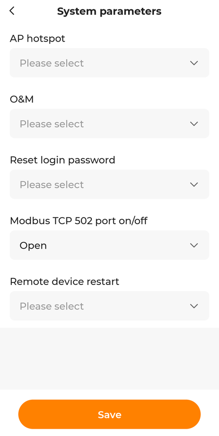

# Preparing the inverter: WiNet-S and Modbus TCP

[Deutsche Fassung](setup-winet.de.md)

sungrow-local reads the inverter through the **WiNet-S** communication dongle that sits in
the inverter's COM port. Two things are needed: the dongle must be in your network, and its
Modbus TCP port must be switched on.

## 1. Bring the WiNet-S into your network

The WiNet-S can join your network over Wi-Fi or with a network cable.

- **A cable is the better choice.** Modbus over the dongle is a lot more stable on a cable.
  If the inverter is far from the router, a pair of powerline adapters works fine (the
  tested system uses exactly that).
- The dongle gets its address from your router by DHCP. Find it in the router's list of
  devices. It may show up as "Espressif" (the chip inside), and on the tested system the
  MAC address started with `ac:19:9f` (Sungrow).
- **It may not answer a ping.** If a network scan does not find it, look at the router's
  DHCP list or the ARP table (`arp -a`) instead.
- **Give it a fixed address** with a DHCP reservation in your router, so that the dashboard
  always finds it under the same IP.

## 2. Switch on Modbus TCP

Out of the box, port 502 on the WiNet-S is closed. There are two ways to open it.

> **Read this first.** Modbus TCP has no login. Once port 502 is open, *every* device that
> can reach the dongle can read the inverter, and you should assume it can also write
> settings (battery mode, forced charging, export limit). sungrow-local itself only reads,
> but it cannot protect the port it needs. Keep the WiNet-S in a network segment where only
> the machine running sungrow-local may reach port 502, see
> [Lock down the WiNet-S](block-cloud.md#lock-down-the-winet-s).

### Way A: iSolarCloud app

1. Open the plant in the iSolarCloud app.
2. In the device list choose the communication module, your **WiNet-S**, and open its
   settings.
3. Go to **System parameters**.
4. Set **Modbus TCP 502 port on/off** to **Open**.
5. Tap **Save**.



The screen above is from the tested system. Menu names can differ slightly between app
versions. If you do not see the option, your account may not have the rights for it;
installer accounts show more settings, so ask your installer to switch it on.

### Way B: local web interface of the dongle

1. Press the button on the WiNet-S **three times briefly**. The dongle opens its own Wi-Fi
   hotspot. Do not hold the button down, a long press can reset the dongle.
2. Connect to that Wi-Fi and open `http://11.11.11.1` in a browser.
3. Log in with the admin account. The default password is in Sungrow's WiNet-S manual;
   the "user" login does not show the Modbus settings. **Change the default password**
   while you are there: this web interface stays reachable from your network.
4. Go to **System → Transfer Configuration**, find the Modbus TCP settings and switch on
   **Local Port**. Save.

## 3. Check the connection

```sh
python3 sungrow_local.py --check
```

This prints one complete reading as JSON. Alternatively `nc -z <ip-of-winet> 502` tells you
whether the port is open. The Modbus **unit id is 1**.

## Troubleshooting

| Symptom | Cause and fix |
|---|---|
| `ConnectionRefusedError` | Modbus TCP is not switched on, or the IP address is wrong. |
| `ReadTimeout` or `timeout` | The dongle answers too slowly or not at all. Check the cable or Wi-Fi and that no other Modbus client is connected. |
| `ConnectionResetError` or "connection closed by inverter" | Another Modbus client is connected to the dongle at the same time (Home Assistant, evcc, a second copy of sungrow-local), or requests come too fast. Stop the other client or raise `request_pause` to 0.5. |
| `Modbus exception 2` | The model uses a different register map. Please open an issue with model and firmware version. |
| Daily values jump at midnight | The counters reset at midnight in the inverter's clock. If the clock is wrong, the day boundary is wrong too. See [block-cloud.md](block-cloud.md). |
| Everything is 0 at night | Normal, there is no PV power and the battery may be idle. |
